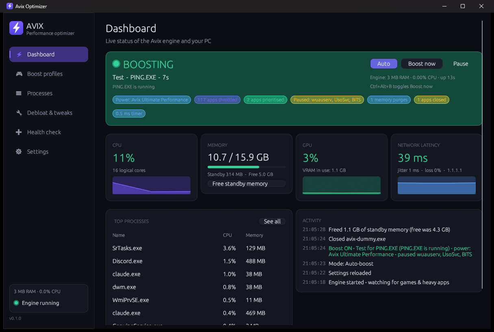
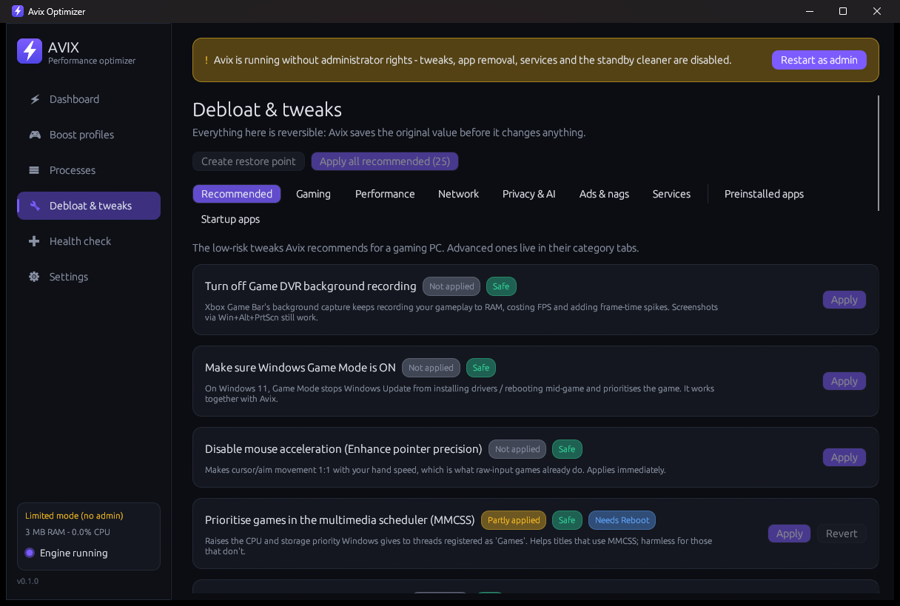

# Avix

**A tiny, real-time performance optimizer and debloater for Windows 10/11 — built in Rust.**

Avix sits in your tray using ~3 MB of RAM. The moment a game, stream or local AI model starts, it
switches your PC into a tuned "boost" state, keeps it there while you play, and puts **everything**
back exactly as it was when you're done.

| | Measured on a Ryzen 7 5700X / RTX 3060 / 16 GB |
|---|---|
| Engine (tray, always on) | **~2.5 MB** private RAM, **~0.02 %** CPU |
| Dashboard (only while open) | ~53 MB RAM (mostly the GPU driver), ~0.06 % CPU — fully freed when closed |
| Binary | single 4.9 MB `Avix.exe`, no runtime, no installer |




---

## What the boost does

When an app from a profile starts (or *any* app goes fullscreen), Avix:

1. **Switches power plan** to *Avix Ultimate Performance* — a copy of Windows' hidden Ultimate plan,
   tuned for latency: USB selective suspend **off** (no sleepy mice/headsets), PCIe link power saving
   off, cores never parked, CPU min state 100 %, no disk/system sleep. Your previous plan comes back after.
2. **Raises your game** to High priority and opts it out of EcoQoS.
3. **Throttles everything else in your session** — Below-normal CPU priority, *Efficiency mode* (EcoQoS),
   lower memory priority and **low disk I/O priority** — so background apps stop stealing CPU time and
   disk bandwidth from your game. The window you're looking at is always exempt (alt-tab stays snappy).
4. **Pauses Windows Update, Update Orchestrator, Delivery Optimization and BITS**, so nothing downloads,
   installs or seeds updates mid-match (the #1 hidden cause of random network lag), and restarts them after.
5. **Cleans the standby list** when free RAM runs low (like ISLC) — fixes stutter on RAM-tight systems.
6. Optionally: requests 0.5 ms timer resolution, closes apps you pick, keeps companions (e.g. OBS) responsive.

Everything is applied to newly started apps too, and restored *exactly* afterwards (original priority,
EcoQoS state, memory and I/O priority — per process). A crash-safe journal means even if Avix is killed
mid-boost, the next start undoes it.

### Anti-cheat safety (VALORANT, LoL, Fortnite, Apex, CoD …)

Avix **never** injects, reads or writes game memory, and never installs drivers. For games with kernel
anti-cheat (Vanguard, EAC, BattlEye, Ricochet…) Avix doesn't even open a handle to the game process — it
optimizes everything *around* the game. To raise a protected game's own priority, Avix uses Windows'
built-in *launch priority* (Image File Execution Options `CpuPriorityClass`), which Windows applies when
the game starts. Anti-cheat services, voice chat, audio and peripheral software (G HUB, Synapse, iCUE…)
are on a **never touch** list.

### Profiles (all editable)

| Profile | Triggers (examples) | Notes |
|---|---|---|
| **Gaming** | VALORANT, CS2, Fortnite, Apex, LoL, Overwatch, R6, CoD, GTA V, Rocket League, Dota 2, Marvel Rivals… | High priority, standby cleaner, OBS kept responsive |
| **Streaming** | OBS, Streamlabs, XSplit | Above-normal priority for the encoder |
| **AI / Compute** | Ollama, llama.cpp, LM Studio, KoboldCpp, Jan, GPT4All, ComfyUI, Blender | Only boosts while the app is actually working (CPU threshold) |

Plus **auto-detect**: anything that goes fullscreen is boosted with the Gaming profile (browsers and
video players excluded), and the dashboard offers to add it to a profile.

---

## Debloat & tweaks (every change is reversible)

Before touching anything, Avix records the original value (`tweak_backup.json`). Each tweak has
**Apply / Revert**, a risk label and an honest description. There's also a *Create restore point* button.

- **Gaming:** Game DVR background recording off, Game Mode on, mouse acceleration off, MMCSS game priority,
  VALORANT launch priority, *(advanced)* exclusive-fullscreen preference, MPO off, global timer requests,
  Memory Integrity (HVCI) off — clearly marked as a security trade-off.
- **Performance:** foreground CPU reservation, Edge background/startup boost off, Widgets off, Fast Startup off…
- **Network:** multimedia network throttling off, **stop Windows uploading updates to strangers (P2P)**, Nagle off for TCP games.
- **Privacy & AI:** telemetry minimum + services + scheduled tasks (incl. CompatTelRunner CPU spikes),
  Copilot off, Recall off, advertising ID, activity history, Bing in Start search…
- **Ads & nags:** silently installed apps, Start/lock-screen ads, "finish setting up your device", feedback prompts.
- **Services:** Maps, Retail Demo, Fax; *(optional)* SysMain, Search indexer, Print Spooler.
- **Preinstalled apps:** scans what's actually installed and removes Store bloat for all users
  (and stops it being re-provisioned). Things games/Windows need (Xbox Identity Provider, Store, frameworks…) are never listed.
- **OneDrive** uninstall, **Startup apps** manager (same switch Task Manager uses).

## Health check

Finds the usual suspects behind stutter, input lag and "network lag": monitor running below its max
refresh rate (one-click fix), Wi-Fi instead of Ethernet, **Ethernet linked at 100 Mbps (bad cable)**,
Game DVR, Game Mode, mouse acceleration, HVCI, missing page file, low disk space, pending update reboot,
too many startup apps — plus a live ping / jitter / packet-loss monitor.

---

## Download

Grab **`Avix.exe`** from the [Releases page](../../releases) — no installer, no runtime.

> Early preview (v0.1.x). The exe isn't code-signed yet, so Windows SmartScreen may say
> "Windows protected your PC" — click **More info → Run anyway**.

## Using it

1. Put `Avix.exe` somewhere permanent, e.g. `%LOCALAPPDATA%\Programs\Avix\Avix.exe`.
2. Double-click it → accept the UAC prompt (admin is needed for services, power plans, tweaks).
   The tray icon appears (purple = watching, green = boosting, grey = paused) and the dashboard opens.
3. **Settings → Start Avix with Windows** (uses a Task Scheduler logon task, so no UAC prompt every boot).
4. Recommended first steps: **Debloat & tweaks → Apply all recommended**, then **Health check**, then reboot once.

Tray menu: open dashboard · Auto-boost · Boost now (per profile) · Pause · free standby memory · Exit
(Exit restores everything). **Ctrl+Alt+B** toggles *Boost now*.

### Command line

```
Avix.exe              start engine (if needed) + open dashboard
Avix.exe --tray       engine only (what autostart uses)
Avix.exe --paused     start with auto-boost off
Avix.exe --restore    undo anything left by an interrupted boost
Avix.exe --diag       read-only self-test -> %LOCALAPPDATA%\Avix\avix-diag.txt
Avix.exe --no-elevate run without the UAC prompt (limited mode)
```

Data lives in `%LOCALAPPDATA%\Avix\`: `config.json`, logs, `tweak_backup.json`, `boost-journal.json`.

### Uninstall

Settings → turn off *Start with Windows* → *Remove Avix power plan* → (optionally) Revert tweaks → Exit
from the tray → delete `Avix.exe` and `%LOCALAPPDATA%\Avix`.

---

## Honest limits

- Avix can't fix lag caused by your ISP, Wi-Fi interference, the game server, or a GPU that's simply maxed out.
- VALORANT/CS2 use UDP, so "Nagle off" won't change their ping (it's labelled as such).
- On Windows 11 a 0.5 ms timer request only reaches games if *Allow global timer-resolution requests* is applied.
- Some services (e.g. Update Orchestrator) may refuse to pause on some builds — Avix logs it and carries on.

---

## Building from source

Requirements: Rust (stable). Then:

```powershell
powershell -ExecutionPolicy Bypass -File .\build.ps1   # -> dist\Avix.exe
```

Notes:
- It builds with rustup's **GNU** toolchain (`x86_64-pc-windows-gnu`, no Visual Studio needed).
  `Cargo.lock` pins a few crates (`parking_lot`, `libloading`, `arboard`, `webbrowser`) to releases that
  don't use `raw-dylib`, because that needs a full MinGW `dlltool` + assembler. Build with `--locked` and
  don't `cargo update` those unless you switch to the MSVC toolchain (Visual Studio Build Tools), where the
  pins can be dropped. `build.rs` also provides an empty `libshlwapi.a` stub for the same reason.
- Code layout:
  - `src/engine/` – boost state machine, tray + message loop, crash-safe journal
  - `src/sys/` – Win32/NT wrappers (process snapshot, priorities/EcoQoS/IO priority, power plans, services,
    registry, memory lists, GPU counters, ICMP ping, displays)
  - `src/tweaks/` – tweak catalogue with backup/revert, Store-app removal, startup apps, scheduled tasks
  - `src/ui/` – egui dashboard (only runs while open)
  - `src/ipc.rs` – engine ⇄ dashboard named pipe (local only, owner-only writes)

## License

[MIT](LICENSE) © 2026 Avilash Ghosh

## Before sharing it publicly

- **Code-sign the exe** (otherwise SmartScreen warns "unknown publisher" — an OV/EV certificate or Azure Trusted Signing fixes it).
- Build with the MSVC toolchain for release builds, add an installer/updater and an `.ico` resource.
- Expand per-game defaults and translate descriptions as needed.
