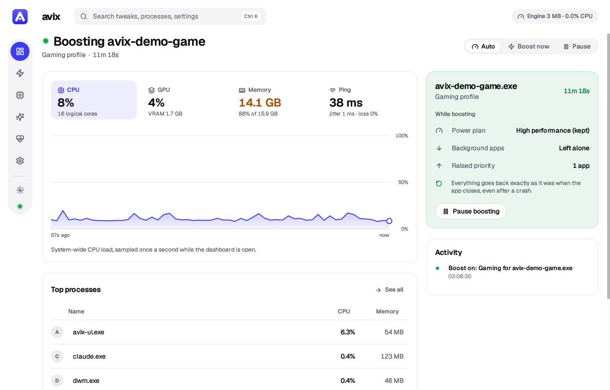
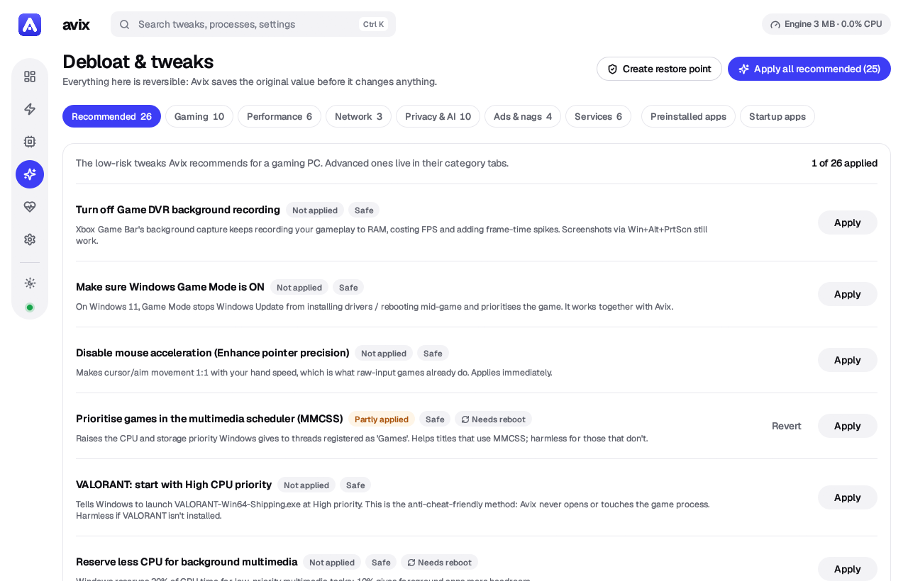
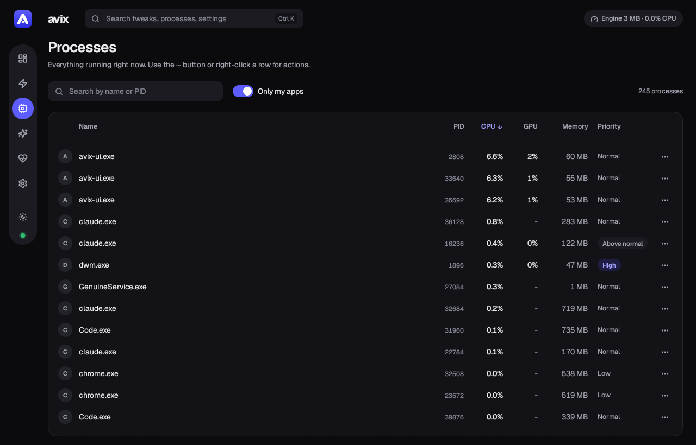
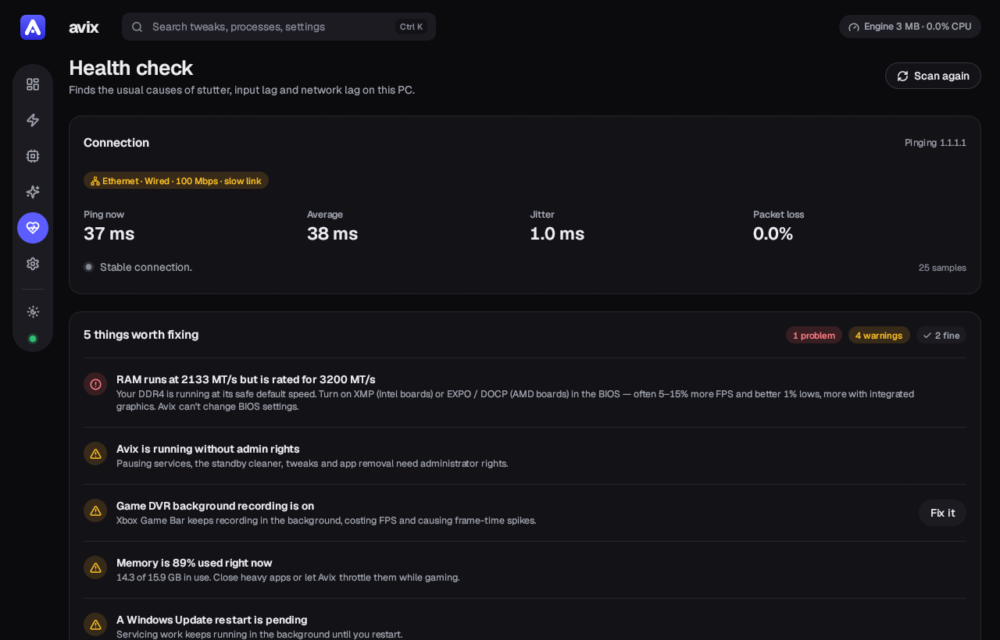
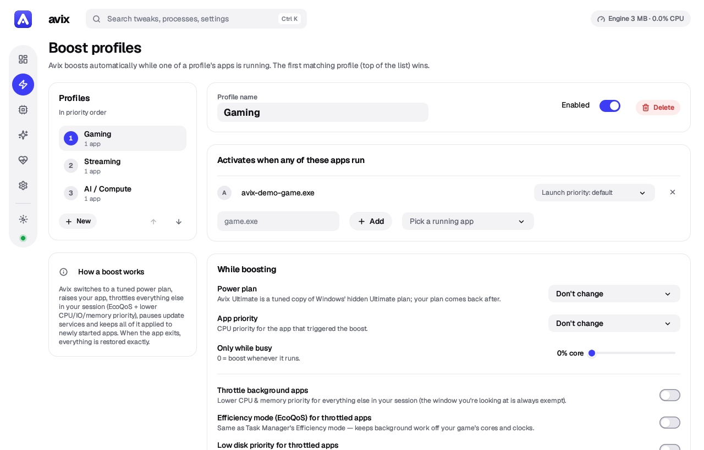
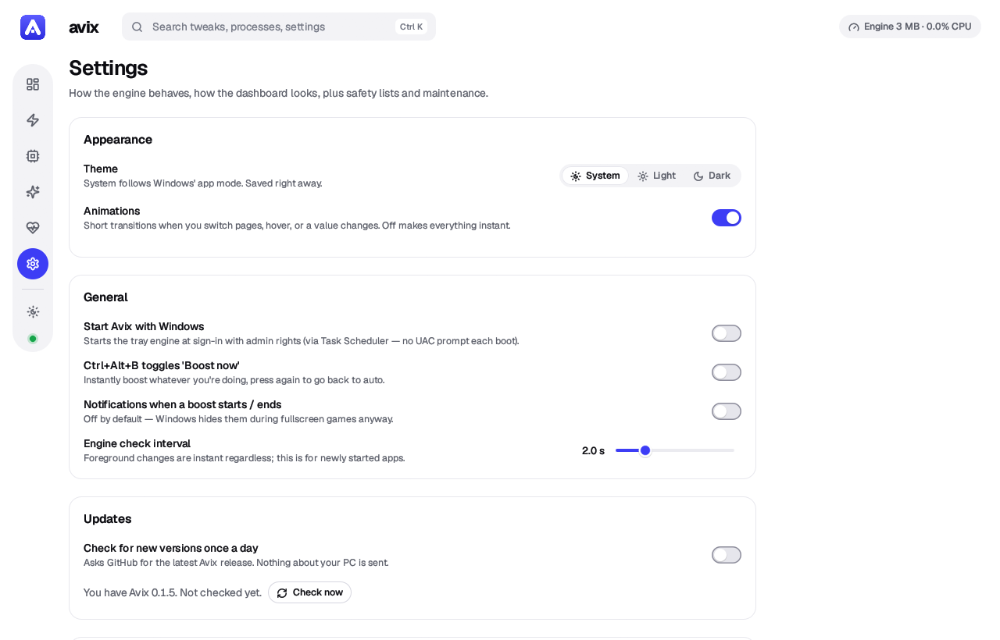

<p align="center">
  
</p>

<h1 align="center">Avix</h1>

<p align="center">
  <b>A tiny, real-time performance optimizer and debloater for Windows 10/11 — built in Rust.</b>
</p>

<p align="center">
  <a href="../../releases/latest"></a>
  
  
  <a href="LICENSE"></a>
  <a href="https://buymeacoffee.com/avilashghop"></a>
</p>

Avix sits in your tray using ~2.5 MB of RAM. The moment a game, stream or local AI model starts, it switches
your PC into a tuned **boost** state, keeps it there while you play, and puts **everything** back exactly as
it was when you're done.

<picture>
  <source media="(prefers-color-scheme: dark)" srcset="docs/screenshots/dashboard-dark.png">
  
</picture>

|                              | Measured on a Ryzen 7 5700X / RTX 3060 / 16 GB                                  |
|------------------------------|---------------------------------------------------------------------------------|
| **Engine** (tray, always on) | ~2.5 MB private RAM, ~0.02 % CPU                                                |
| **Dashboard** (only while open) | ~55 MB RAM (mostly the GPU driver), ~0.06 % CPU — fully freed when closed    |
| **Binary**                   | a single 4.1 MB `Avix.exe`, no runtime, no installer                            |

<p align="center">
  <a href="../../releases/latest"><b>Download Avix.exe</b></a> ·
  <a href="#what-the-boost-does">What it does</a> ·
  <a href="#debloat--tweaks">Debloat</a> ·
  <a href="#health-check">Health check</a> ·
  <a href="#using-it">Using it</a> ·
  <a href="PRIVACY.md">Privacy</a> ·
  <a href="CONTRIBUTING.md">Contribute</a>
</p>

---

## What the boost does

When an app from a profile starts (or *any* game is detected), Avix:

| | |
|---|---|
| **1. Power plan** | Switches to *Avix Ultimate Performance* — a copy of Windows' hidden Ultimate plan, tuned for latency: USB selective suspend **off** (no sleepy mice or headsets), PCIe link power saving off, cores never parked, CPU min state 100 %, no disk/system sleep. Your previous plan comes back after. |
| **2. Your game first** | Raises the game to High priority and opts it out of EcoQoS. |
| **3. Everything else waits** | Background apps in your session get Below-normal CPU priority, *Efficiency mode* (EcoQoS), lower memory priority and **low disk I/O priority**, so they stop stealing CPU time and disk bandwidth from the game. The window you're looking at is always exempt, so alt-tab stays snappy. |
| **4. No surprise downloads** | Pauses Windows Update, Update Orchestrator, Delivery Optimization and BITS, so nothing downloads, installs or seeds updates mid-match (the #1 hidden cause of random network lag), and restarts them after. |
| **5. Memory when it's tight** | Cleans the standby list when RAM runs low (like ISLC), and at 80 % RAM use makes throttled background apps hand their memory back. A big difference on 8 GB PCs. |
| **6. The right GPU** | Laptops with two GPUs: sets Windows' graphics preference so each boosted game runs on the dedicated GPU from its next launch. Choices you made yourself are never overridden. |
| **7. Optional extras** | Requests 0.5 ms timer resolution, closes apps you pick, keeps companions (e.g. OBS) responsive. |

Everything also applies to apps that start mid-boost, and is restored *exactly* afterwards — original
priority, EcoQoS state, memory and I/O priority, per process. A crash-safe journal means that even if Avix
is killed mid-boost, the next start undoes it.

### Anti-cheat safe (VALORANT, LoL, Fortnite, Apex, CoD …)

Avix **never** injects, reads or writes game memory, and never installs drivers. For games with kernel
anti-cheat (Vanguard, EAC, BattlEye, Ricochet…) Avix doesn't even open a handle to the game process — it
optimizes everything *around* the game. To raise a protected game's own priority, Avix uses Windows'
built-in *launch priority* (Image File Execution Options `CpuPriorityClass`), which Windows applies when
the game starts. Anti-cheat services, voice chat, audio and peripheral software (G HUB, Synapse, iCUE…)
are on a **never touch** list.

### Profiles (all editable)

| Profile | Triggers (examples) | Notes |
|---|---|---|
| **Gaming** | VALORANT, CS2, Fortnite, Apex, LoL, Overwatch, R6, CoD, GTA V, Rocket League, Dota 2, Marvel Rivals… | High priority, standby cleaner, OBS kept responsive |
| **Streaming** | OBS, Streamlabs, XSplit | Above-normal priority for the encoder |
| **AI / Compute** | Ollama, llama.cpp, LM Studio, KoboldCpp, Jan, GPT4All, ComfyUI, Blender | Only boosts while the app is actually working (CPU threshold) |

### Games it finds on its own

No list to keep up to date: auto-detect works whether the game started before or after Avix, fullscreen
or windowed. A game counts if:

- **Windows recognises it** — the list Xbox Game Bar and Game Mode use (matched by full exe path), or
- **it runs from a game store's library** with a real window — Steam, Epic, GOG, Ubisoft, EA, Xbox,
  itch.io, Amazon Games, or any folder named `Games` (launchers, overlays, installers and crash handlers
  are skipped), or
- **it goes fullscreen**, even if it isn't the window in focus (browsers and video players excluded), or
- **it's the app you're using and keeps the GPU's 3D engine busy** (≥ 20 % for a few seconds) — this
  catches games from anywhere. It stops counting after 2 minutes idle; the GPU counters are only opened
  while checking.

Detected games use the Gaming profile, and the dashboard offers to add the GPU/fullscreen ones to a
profile. Each source can be switched off in **Settings → Auto-detect games**.

---

## Debloat & tweaks

**Every change is reversible.** Before touching anything, Avix records the original value
(`tweak_backup.json`). Each tweak has **Apply / Revert**, a risk label and an honest description, and
there's a *Create restore point* button.



| Area | What's in it |
|---|---|
| **Gaming** | Game DVR background recording off, Game Mode on, mouse acceleration off, MMCSS game priority, optimizations for windowed games (lower latency in borderless mode), VALORANT launch priority; *advanced:* exclusive-fullscreen preference, MPO off, global timer requests, Memory Integrity (HVCI) off — clearly marked as a security trade-off |
| **Performance** | Foreground CPU reservation, Edge background/startup boost off, Fast Startup off, window animations off… |
| **Network** | Multimedia network throttling off, **stop Windows uploading updates to strangers (P2P)**, Nagle off for TCP games |
| **Privacy & AI** | Telemetry minimum + services + scheduled tasks (incl. CompatTelRunner CPU spikes), Copilot off, Recall off, advertising ID, activity history, Bing in Start search… |
| **Ads & nags** | Silently installed apps, Start/lock-screen ads, "finish setting up your device", feedback prompts |
| **Services** | Maps, Retail Demo, Fax; *optional:* SysMain, Search indexer, Print Spooler |
| **Preinstalled apps** | Scans what's actually installed and removes Store bloat (incl. Widgets) for all users, and stops it being re-provisioned. Things games and Windows need (Xbox Identity Provider, Store, frameworks…) are never listed |
| **Also** | **OneDrive** uninstall, and a **Startup apps** manager (the same switch Task Manager uses) |

## Health check

Finds the usual suspects behind stutter, input lag and "network lag": a monitor running below its max
refresh rate (one-click fix), Wi-Fi instead of Ethernet, **Ethernet linked at 100 Mbps (bad cable)**,
Game DVR, Game Mode, mouse acceleration, HVCI, a missing page file, low disk space, a pending update
reboot, too many startup apps — plus a live ping / jitter / packet-loss monitor.

**Hardware set-up** — the problems that cost the most FPS, especially on budget PCs, which Avix can spot
but not change for you:

- **RAM running below its rated speed** (XMP / EXPO off in the BIOS), read from the firmware and the
  sticks' part numbers
- **only one RAM stick, or both in the same channel**, so it runs single-channel
- **old graphics drivers**, or no graphics driver at all
- **games installed on a hard drive**
- **a laptop on battery or in battery saver**
- **two GPUs**, with the advice to keep games on the dedicated one

## The dashboard

<table>
  <tr>
    <td width="50%"></td>
    <td width="50%"></td>
  </tr>
  <tr>
    <td></td>
    <td></td>
  </tr>
</table>

- **Light and dark**, or follow Windows — switch from the sidebar or **Settings → Appearance**.
- **Short, quiet animations** for page changes, hovers and toggles; turn them off in **Settings → Appearance**.
  Live numbers update in place, so the open dashboard stays at ~0.06 % CPU.
- **Search everything** with **Ctrl+K**: pages, settings, tweaks and running processes. **Ctrl+1 … 6** jump
  between pages, **Ctrl+S** saves pending changes.
- Works from a small window to full screen: columns stack and tables drop secondary columns as it narrows.

---

## Download

Grab **`Avix.exe`** from the [Releases page](../../releases) — no installer, no runtime.

> [!NOTE]
> Early preview (v0.1.x). The exe isn't code-signed yet, so Windows SmartScreen may say
> "Windows protected your PC" — click **More info → Run anyway**. See
> [code signing](#code-signing).

**Privacy:** no telemetry, no accounts. The update check (opt-in) and the dashboard's ping monitor are
the only network traffic, and both can be turned off: [PRIVACY.md](PRIVACY.md).

## Using it

1. Put `Avix.exe` somewhere permanent, e.g. `%LOCALAPPDATA%\Programs\Avix\Avix.exe`.
2. Double-click it and accept the UAC prompt (admin is needed for services, power plans and tweaks).
   The tray icon appears — **blue** = watching, **green** = boosting, **grey** = paused — and the
   dashboard opens.
3. **Settings → Start Avix with Windows** (a Task Scheduler logon task, so no UAC prompt every boot).
4. Recommended first steps: **Debloat & tweaks → Apply all recommended**, then **Health check**, then
   reboot once.

**Tray menu:** open dashboard · Auto-boost · Boost now (per profile) · Pause · free standby memory · Exit
(Exit restores everything). **Ctrl+Alt+B** toggles *Boost now* from anywhere.

**Updates:** once a day Avix asks GitHub for the latest release (a single HTTPS request; nothing about
your PC is sent). When there's a new version, the tray shows a one-time notification (never mid-game),
the tray menu gets *Update available*, and the dashboard shows a **Download** button. To update, download
the new `Avix.exe`, exit Avix from the tray, and replace the old file — your settings stay. Turn this
off, or check right away, in **Settings → Updates**.

### Command line

```
Avix.exe              start engine (if needed) + open dashboard
Avix.exe --tray       engine only (what autostart uses)
Avix.exe --paused     start with auto-boost off
Avix.exe --restore    undo anything left by an interrupted boost
Avix.exe --diag       read-only self-test -> %LOCALAPPDATA%\Avix\avix-diag.txt
Avix.exe --no-elevate run without the UAC prompt (limited mode)
```

Data lives in `%LOCALAPPDATA%\Avix\`: `config.json`, logs, `tweak_backup.json`, `boost-journal.json`,
`update.json` (last update check).

### Uninstall

Settings → turn off *Start with Windows* → *Remove Avix power plan* → (optionally) revert tweaks → Exit
from the tray → delete `Avix.exe` and `%LOCALAPPDATA%\Avix`.

## Honest limits

- Avix can't fix lag caused by your ISP, Wi-Fi interference, the game server, or a GPU that's simply maxed out.
- VALORANT and CS2 use UDP, so "Nagle off" won't change their ping (it's labelled as such).
- On Windows 11 a 0.5 ms timer request only reaches games if *Allow global timer-resolution requests* is applied.
- Some services (e.g. Update Orchestrator) may refuse to pause on some builds — Avix logs it and carries on.

---

## Building from source

Requirements: Rust (stable). Then:

```powershell
powershell -ExecutionPolicy Bypass -File .\build.ps1   # -> dist\Avix.exe
```

<details>
<summary><b>Toolchain notes and code layout</b></summary>

- It builds with rustup's **GNU** toolchain (`x86_64-pc-windows-gnu`, no Visual Studio needed).
  `Cargo.lock` pins a few crates (`parking_lot`, `libloading`, `arboard`, `webbrowser`) to releases that
  don't use `raw-dylib`, because that needs a full MinGW `dlltool` + assembler. Build with `--locked` and
  don't `cargo update` those unless you switch to the MSVC toolchain (Visual Studio Build Tools), where the
  pins can be dropped. `build.rs` also provides an empty `libshlwapi.a` stub for the same reason.
- Code layout:
  - `src/engine/` – boost state machine, tray + message loop, crash-safe journal
  - `src/sys/` – Win32/NT wrappers (process snapshot, priorities/EcoQoS/IO priority, power plans, services,
    registry, memory lists, GPU counters, ICMP ping, displays)
  - `src/tweaks/` – tweak catalogue with backup/revert, Store-app removal, startup apps, scheduled tasks
  - `src/ui/` – egui dashboard (only runs while open); `theme.rs` holds the colour tokens, type and widgets
  - `src/icon_render.rs` – the app and tray icon, drawn in code (also embedded in the exe by `build.rs`)
  - `src/ipc.rs` – engine ⇄ dashboard named pipe (local only, owner-only writes)
- Fonts are embedded from `assets/fonts/`: [Geist](https://github.com/vercel/geist-font) (SIL Open Font
  License 1.1, four static weights with tabular digits) and [Lucide](https://lucide.dev) icons (ISC),
  both subset to what Avix uses. Their licenses sit next to them.

</details>

<details>
<summary><b>Testing</b></summary>

`avix --diag` is a read-only report. Debug builds also have an **admin integration test**
(`cargo build`, then run `target\debug\avix.exe --selftest` elevated; the report lands in the data
folder). It round-trips every system-changing feature — restore point, power plan create/tune/switch,
standby purge, timer resolution, process priority / EcoQoS / memory / I/O priority, launch priority,
startup toggles, the autostart task, the app-removal script and every not-yet-applied tweak — and checks
the PC is byte-for-byte back where it started (already-applied tweaks are skipped). Set
`AVIX_SELFTEST_ONLY=timer,power,...` to run a subset and `AVIX_DATA_DIR` to keep test data separate.
In debug builds `AVIX_INSTANCE=name` runs a separate engine (own pipe and single-instance lock), so tests
can run next to a real Avix.
v0.1.1 passed all 67 self-test checks plus a 25-check elevated engine run (boost, exact restore,
hard-kill crash recovery).

Debug builds can also screenshot the dashboard for review and for this README:
`AVIX_SHOT=<folder>` renders each page in light and dark and saves PNGs (plus the icon in its three tray
states), then exits. `AVIX_SHOT_PAGES`, `AVIX_SHOT_THEMES`, `AVIX_SHOT_SIZE` and `AVIX_SHOT_SETTLE` narrow
it down; see `src/ui/shot.rs`.

</details>

## Code signing

Releases are not code-signed yet. Every release is built from its tag by GitHub Actions, and
`Avix.exe.sha256` next to it holds the exe's SHA-256, so you can check a download with
`Get-FileHash Avix.exe` in PowerShell. The privacy policy is in [PRIVACY.md](PRIVACY.md): Avix
sends nothing about you or your PC, and its two kinds of network requests are opt-in or can be
turned off.

## Support Avix

Avix is free, has no ads or tracking, and is made by one developer,
[Avilash Ghosh](https://github.com/Avilash2001) ([@AvilashGhosh6 on X](https://x.com/AvilashGhosh6)).
If it made your PC feel better:

- **Star this repository.** It's the main way other gamers find Avix.
- **Tell a friend** with a slow PC, or post about it where you talk about games.
- **[Buy me a coffee](https://buymeacoffee.com/avilashghop)** if you'd like to support development.
  Avix stays free either way.

The same links are in the app under **Settings → About** (or the heart in the sidebar).

## Contributing

Bug reports, games Avix misses, tests on hardware the author doesn't have, and pull requests are
all welcome. [CONTRIBUTING.md](CONTRIBUTING.md) explains how to build Avix, run a test build next
to your own install, and what a good pull request looks like. To report something, open an
[issue](../../issues/new/choose).

## License

[MIT](LICENSE) © 2026 Avilash Ghosh. Bundled fonts: Geist (SIL OFL 1.1) and Lucide (ISC), see
`assets/fonts/`.

---

<details>
<summary><b>Releasing</b></summary>

GitHub Actions ([`.github/workflows/build.yml`](.github/workflows/build.yml)) tests and builds each
pushed `v*` tag on Windows; pushes to `main` and pull requests don't trigger it. For a test build of a
branch, run it by hand (Actions → *Build & release* → *Run workflow*): that only builds, and the run's
*Artifacts* has the exe. It links with rustup's bundled MinGW (`-C link-self-contained=yes`) and the
same `--locked` pins as `build.ps1`, so CI builds match a PC that has only rustup. To ship a version:

1. Bump `version` in `Cargo.toml`. Run a plain `cargo build` once, which updates only Avix's own entry
   in `Cargo.lock`. Commit and push.
2. Tag it with the same version: `git tag v0.1.6` then `git push origin v0.1.6`. CI fails if the tag and
   `Cargo.toml` disagree.
3. CI builds from scratch (no cache for tags), runs the tests, and creates a **draft** release with
   `Avix.exe` and `Avix.exe.sha256` attached.
4. Write the notes and publish. Avix's update check only sees published, non-pre-release releases, so
   nobody is told about a version before its exe is there.

If a release for the tag already exists, CI replaces its `Avix.exe` with the CI build.

</details>

<details>
<summary><b>Before sharing it publicly</b></summary>

### Code signing (removes "Windows protected your PC")

Windows SmartScreen warns about any unsigned download it hasn't seen many times. No code change can fix
that; a code-signing certificate is the real fix. The options, as of November 2026:

- **SignPath Foundation** (free): declined on 2026-11-14. The Foundation first wants public signs of
  adoption (stars, forks, contributors, articles, Reddit or YouTube discussion) and sustained
  activity, and is happy to review a new application then. The CI side is ready; see the steps below.
- **Certum Open Source Code Signing** (about €49 a year, cloud "SimplySign" version): issued to an
  individual developer for open-source work, so it's available now. Signed files show
  *Open Source Developer, Avilash Ghosh*. The key stays in Certum's cloud and each session needs a
  code from the phone app, so signing happens on a PC, not unattended in CI: download the draft
  release's `Avix.exe`, sign it with `signtool`, then upload it and a new `Avix.exe.sha256`.
- **Azure Artifact Signing** (about $10 a month): the best fit for CI, but individuals must live in
  the US or Canada.

To reapply to the SignPath Foundation later:

1. **Apply** at [signpath.org/apply](https://signpath.org/apply). They sign OSI-licensed (MIT is fine),
   maintained, already-released projects with no proprietary code. They want:
   - a *Code signing policy* section on the project page: the SignPath credit line, committers and
     reviewers, and approvers (the first application's version is in the README as of commit
     `2a7ba75`; put it back under [Code signing](#code-signing)),
   - a privacy policy ([PRIVACY.md](PRIVACY.md)),
   - MFA on GitHub and SignPath for everyone on the team.

   Signed files show **SignPath Foundation** as the publisher.
2. **Metadata:** the Foundation enforces product name/version metadata. `Avix.exe` carries a version
   resource (product name `Avix`, version = `Cargo.toml`), written by `build.rs` together with the
   manifest and the icon. Use those values in SignPath's artifact configuration.
3. **Once accepted**, in SignPath:
   - Link the predefined *GitHub.com* trusted build system to the project.
   - Add a CI user as *Submitter* of the release signing policy.
   - Use an artifact configuration with a root `<pe-file path="Avix.exe">` and `<authenticode-sign/>`.
     The workflow uploads the exe unzipped.
4. **Repository secrets** (Settings → Secrets and variables → Actions):
   - `SIGNPATH_API_TOKEN`: the CI user's API token
   - `SIGNPATH_ORGANIZATION_ID`

   Set the project and signing-policy slugs in `build.yml`, then uncomment its *Sign with SignPath* and
   *Use the signed Avix.exe* steps. Each release then waits until an approver approves the signing
   request in SignPath.

Even a signed exe can still show SmartScreen for a while. Windows builds reputation per file and
certificate as people download and run it, so the first downloads of a new release may still see the
warning. It names the publisher instead of "Unknown publisher" and stops much sooner.

### Also worth doing

- A one-click updater (download, verify the SHA-256, swap the exe, restart).
- Test on Windows 10, and expand per-game defaults.

</details>
